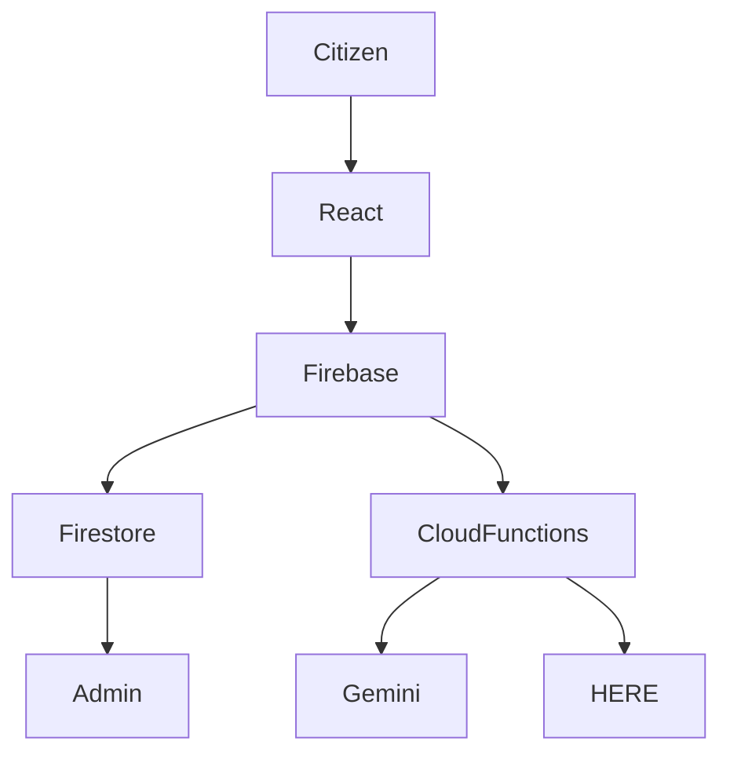

# 🚀 CitFix - AI Powered Civic Issue Reporting & Management Platform

> **🏆 Built for Tech24 Hackathon by GDG Mohan Babu University**

<p align="center">


</p>

---

## 📖 Table of Contents

- Overview
- Problem Statement
- Features
- Tech Stack
- Architecture
- AI Workflow
- Project Structure
- Installation
- Environment Variables
- Security
- Database Design
- API Endpoints
- Screens
- Roadmap
- Deployment
- Team
- License

---

# 🌍 Overview

**CitFix** is an AI-powered civic issue reporting and management platform that enables citizens to report infrastructure issues while providing municipal authorities with an intelligent dashboard to triage, prioritize, assign, and resolve them.

Citizens can report:

- 🛣️ Potholes
- 🗑️ Garbage Dumps
- 💧 Water Leakage
- ⚡ Electricity Issues
- 🚦 Traffic Problems
- 🚨 Public Safety Hazards

Every complaint includes:

- 📍 GPS Location
- 🖼️ Images
- 🤖 AI Analysis
- 📊 Priority Score
- 🔥 Severity
- 🗺️ Smart Routing
- 🔔 Notifications

---

# ❗ Problem Statement

Conventional civic complaint systems suffer from:

- Slow processing
- Duplicate complaints
- Manual prioritization
- Lack of transparency
- No AI assistance
- Poor communication

CitFix addresses these through automation, AI, and real-time collaboration.

---

# ✨ Key Features

## Citizen Portal

- Report civic issues
- Upload photos
- Auto-detect location
- Track issue status
- Real-time notifications
- Interactive maps

## Admin Portal

- Live dashboard
- Accept / Reject issues
- AI-generated recommendations
- Analytics
- Audit logs
- Department assignment

## AI Features

- Category prediction
- Severity estimation
- Urgency scoring
- Confidence score
- Recommended action
- Smart prioritization

---

# 🛠 Tech Stack

## Frontend

- React 18
- Vite
- TypeScript
- Tailwind CSS
- shadcn/ui
- React Router
- React Hook Form
- Leaflet

## Backend

- Firebase Authentication
- Cloud Firestore
- Cloud Functions
- Firebase Hosting

## AI

- Google Gemini 1.5

## Maps

- HERE Routing API

---

# 🏗 System Architecture



---

# 🤖 AI Workflow

```text
Citizen Report
      │
      ▼
Cloud Function Trigger
      │
      ▼
Gemini Analysis
      │
 ┌────┼────┐
 ▼    ▼    ▼
Category Severity Priority
      │
      ▼
Recommendation
      │
      ▼
Firestore Update
      │
      ▼
Admin Dashboard
```

---

# 📂 Project Structure

```text
CitFix
├── src
│   ├── components
│   ├── contexts
│   ├── hooks
│   ├── lib
│   ├── pages
│   ├── services
│   ├── utils
│   └── assets
├── functions
│   └── src
├── firestore.rules
├── firebase.json
├── vite.config.ts
└── package.json
```

---

# 🚀 Getting Started

## Clone

```bash
git clone https://github.com/USERNAME/CitFix.git
cd CitFix
```

## Install

```bash
npm install
```

## Development

```bash
npm run dev
```

## Production Build

```bash
npm run build
```

---

# 🔐 Environment Variables

```env
VITE_FIREBASE_API_KEY=
VITE_FIREBASE_AUTH_DOMAIN=
VITE_FIREBASE_PROJECT_ID=
VITE_FIREBASE_STORAGE_BUCKET=
VITE_FIREBASE_MESSAGING_SENDER_ID=
VITE_FIREBASE_APP_ID=

GEMINI_API_KEY=
HERE_API_KEY=
```

---

# 🔒 Security

- Firestore Security Rules
- Role-Based Access Control
- Secure Cloud Functions
- Hidden API Keys
- Firestore Transactions
- Audit Logging
- Notification Privacy
- AI Field Isolation

---

# 🗄 Database Collections

- users
- issues
- notifications
- audit_logs
- departments

---

# 📡 Cloud Functions

| Function | Purpose |
|----------|---------|
| onIssueCreate | AI triage |
| acceptIssue | Admin workflow |
| route | HERE API proxy |

---

# 📱 Screens

- Landing Page
- Citizen Dashboard
- Report Issue
- Map View
- Admin Dashboard
- Analytics
- Notifications

> Add screenshots inside `/assets/screenshots` and reference them here.

---

# 🚀 Deployment

## Firebase

```bash
firebase deploy
```

## Vercel

```bash
vercel --prod
```

---

# 🧪 Quality

- TypeScript
- ESLint
- Firebase Rules
- Cloud Functions
- Responsive UI
- Production Build

---

# 🛣 Roadmap

- Duplicate detection
- AI image analysis
- Native mobile apps
- Push notifications
- Multi-language support
- Department SLA tracking
- Predictive analytics

---

# 👨‍💻 Team

Built with ❤️ during the **Tech24 Hackathon** organized by **GDG Mohan Babu University**.

---

# 📄 License

This project is released for educational and hackathon purposes.

---

# ⭐ Support

If you found this project useful, consider giving it a **⭐** on GitHub.

<p align="center">

**Built with React • Firebase • Google Gemini • HERE Maps**

**Making cities smarter, one issue at a time.**

</p>
